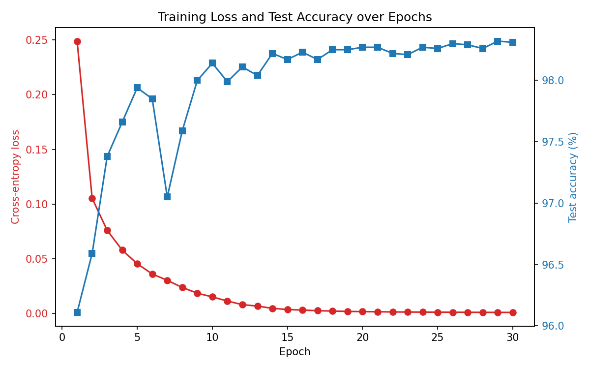

# MNIST Digit Classifier — Built from Scratch with NumPy

A feedforward neural network that classifies handwritten digits (0–9), implemented in raw NumPy — no PyTorch, TensorFlow, or scikit-learn for the model itself. Forward pass, loss, backprop, and the optimizer are all hand-written.

**Architecture:** 784 (input) → 128 (hidden, ReLU) → 10 (output, softmax)
**Result:** 98.31% test accuracy, trained for 30 epochs with mini-batch gradient descent.



## Run it

```bash
python3 train.py      # trains, saves trained_params.npz + loss_curve.png
python3 evaluate.py   # reports test accuracy using the saved weights
```

## Files

| File | What it does |
|---|---|
| `data_loader.py` | Loads MNIST (60k train / 10k test), normalizes, one-hot encodes |
| `network.py` | Forward pass, loss, manual backprop, SGD update |
| `train.py` | Training loop, loss/accuracy tracking, plotting |
| `evaluate.py` | Test-set evaluation, per-digit accuracy |

Full math derivation (forward pass, cross-entropy, backprop chain rule, why softmax+cross-entropy simplifies to `A2 - Y`) is in [MATH.md](MATH.md).
